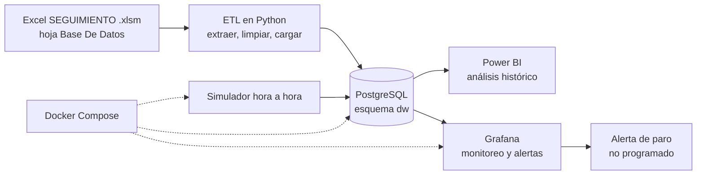

# G. Arquitectura y gobierno de datos

> **Borrador.** Pendiente de revisión del equipo. «Pregunta» marca una decisión abierta y «por verificar», un dato por confirmar.

## G1. Diagrama de arquitectura

Cómo leerlo: el Excel es una carga histórica, que se ejecuta una vez o cuando se actualiza el archivo. El simulador representa el flujo continuo que hoy no existe. Power BI y Grafana leen la misma base, así que ambas ven las mismas definiciones de máquina, turno y causa. Docker Compose levanta la base, Grafana y el simulador; Power BI y DBeaver se ejecutan en el equipo y se conectan a los contenedores.

El diagrama de Mermaid se ve renderizado en GitHub. Para el PDF se exporta como imagen desde mermaid.live o desde un editor que lo soporte.

## G2. Comparativo Power BI y Grafana

| Aspecto | Power BI | Grafana |
|---|---|---|
| Pregunta que resuelve | ¿Qué pasó y por qué? Tendencias, comparativos entre años, causas principales | ¿Qué está pasando ahora? ¿Hay que actuar? |
| Usuario | Directivos y coordinación de mantenimiento | Supervisores y personal de mantenimiento |
| Datos | Historia 2022 a 2025 en modelo dimensional con medidas DAX | Lecturas horarias recientes |
| Frecuencia de actualización | Diaria o mensual, al refrescar el modelo | Segundos o minutos, con refresco automático |
| Alertas | No es su fuerte | Sí: reglas con estados y notificaciones |
| Análisis interactivo | Segmentaciones, drill-down, inteligencia de tiempo | Variables y rango de tiempo |
| Decisión que apoya | Inversión, plan de mantenimiento, programación | Reacción inmediata al paro |

Por qué no se intercambian:
- Grafana no ofrece la inteligencia de tiempo ni el modelado semántico de Power BI, y pierde fuerza al comparar años y jerarquías.
- Power BI actualiza por refrescos programados, no por flujo continuo, y su sistema de alertas es limitado.
- Una decisión de inversión necesita historia comparable; una reacción a un paro necesita el dato de hace un minuto.

## G3. Evolución con PLC o SCADA

PLC es el controlador programable que gobierna la máquina; SCADA es el sistema que supervisa y recoge los datos de varias máquinas.

Cómo cambiaría la solución:

| Hoy | Con PLC o SCADA |
|---|---|
| Operaria llena el formato en papel; mantenimiento lo transcribe | La máquina publica contadores y estados automáticamente (protocolos industriales como OPC UA o MQTT) |
| Datos llegan por lotes, con semanas de retraso | Los datos llegan por flujo continuo, con segundos de retraso |
| Sin meta, sin conteo de rechazos | El PLC aporta producción real, velocidad nominal y conteo de rechazos, lo que habilita rendimiento y calidad reales en el OEE |
| La causa de paro se escribe a mano al final del turno | La parada se detecta sola; el operario solo selecciona la causa en una pantalla en la máquina |
| Excel como fuente | Un *broker* de mensajes (como Mosquitto) y una base de series de tiempo (por ejemplo TimescaleDB, extensión de PostgreSQL) |

Qué se conserva: el modelo dimensional, las dimensiones de máquina, turno, referencia y causa, Power BI para el análisis histórico y Grafana para el monitoreo. `fact_lectura_hora` pasaría de recibir datos simulados a recibir datos reales, y el ETL del Excel se mantendría solo para la historia anterior.

Riesgos a mencionar: la seguridad de la red industrial (separarla de la red de oficina), la calidad del conteo de los sensores y la necesidad de definir quién valida las causas de paro.

## G4. Datos personales y seguridad de acceso

### Qué datos personales hay

| Dato | Dónde está | Riesgo |
|---|---|---|
| Nombre de operarias y operarios | Columna `Operario` (34 valores) | Identifica a personas y permitiría medir su desempeño individual |
| Nombre del personal de mantenimiento, algunos completos | Columna `Personal involucrado` | Idem |
| Nombres en el propio archivo Excel | Archivo versionado en `docs/data/` | Quedan expuestos si el repositorio es público |

### Tratamiento previsto

- **Seudonimización en el ETL.** Antes de cargar, cada nombre se reemplaza por un identificador estable (`OP-001`) derivado del nombre normalizado y una sal secreta que vive en `.env`. La base y los tableros nunca ven el nombre.
- **Minimización.** No se carga el nombre del personal de mantenimiento; solo un identificador y el área.
- **Finalidad.** Los tableros miden máquinas, turnos y causas, no personas. Se documenta que no se usan para evaluar individuos.
- **Repositorio.** El `.gitignore` excluye los archivos de datos (`docs/data/`) y el `.env`. **Pregunta:** si el Excel debe estar en el repo, se propone subir una versión ya seudonimizada. ¿Se acepta?
- **Marco normativo.** En Colombia aplica la Ley 1581 de 2012 de protección de datos personales. **Por verificar** con el profesor o con la empresa: si hay una política interna de tratamiento de datos.

### Seguridad de acceso a los tableros

| Capa | Medida |
|---|---|
| Base de datos | Dos roles: `etl_writer` (escribe) y `bi_reader` (solo lectura). Power BI y Grafana usan solo `bi_reader` |
| Credenciales | Variables de entorno en `.env`, fuera del repositorio; `.env.example` con valores falsos versionado |
| Grafana | Acceso anónimo desactivado; usuarios con rol Viewer (supervisores) o Editor (mantenimiento); administrador con contraseña distinta |
| Power BI | Publicación con acceso restringido por grupo; si hiciera falta, seguridad a nivel de fila (RLS) por máquina |
| Red | La base no se expone fuera del equipo ni de la red de Docker, salvo el puerto que usa DBeaver y Power BI en el equipo anfitrión |
